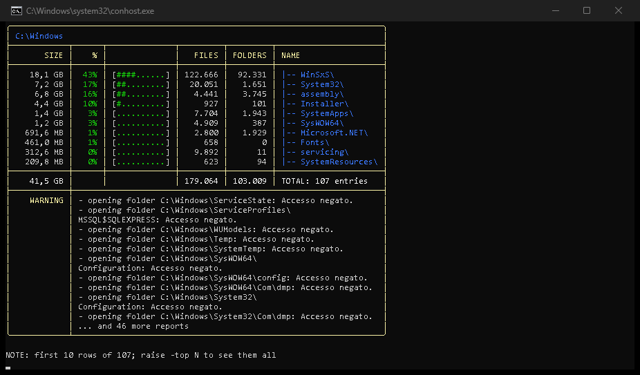
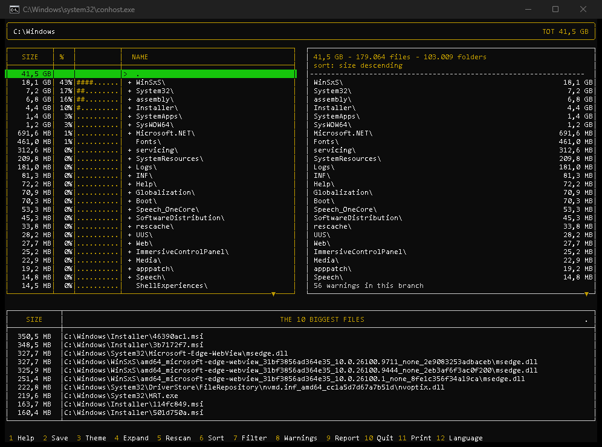
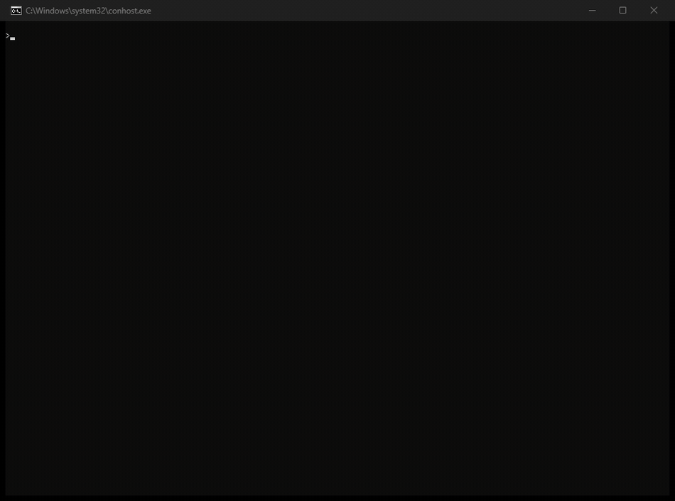
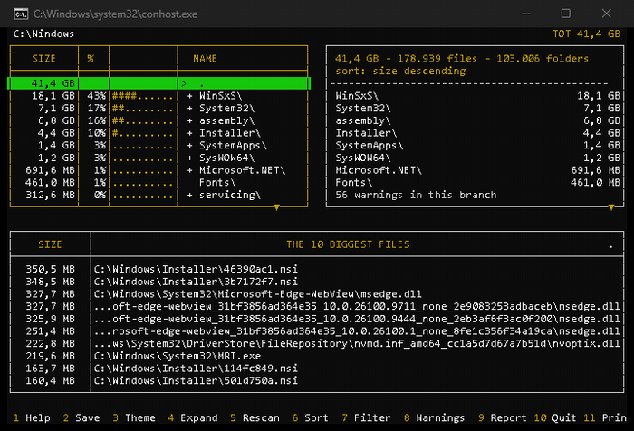
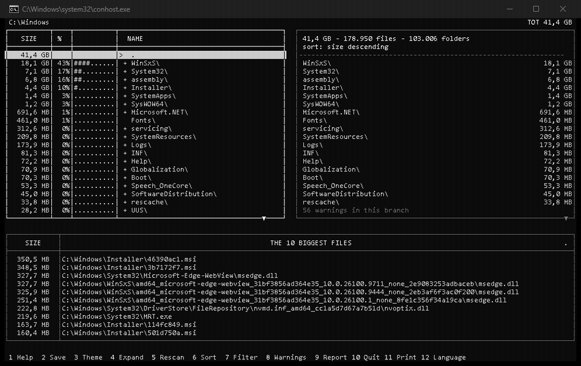
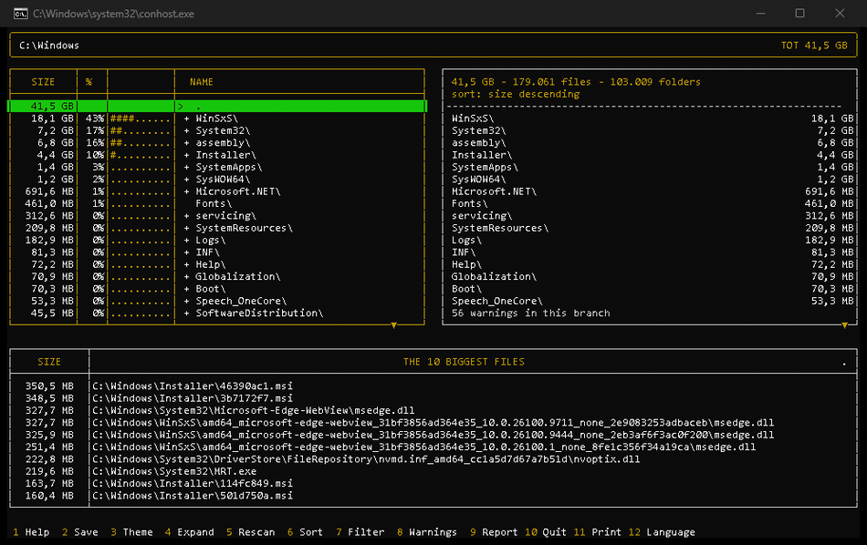
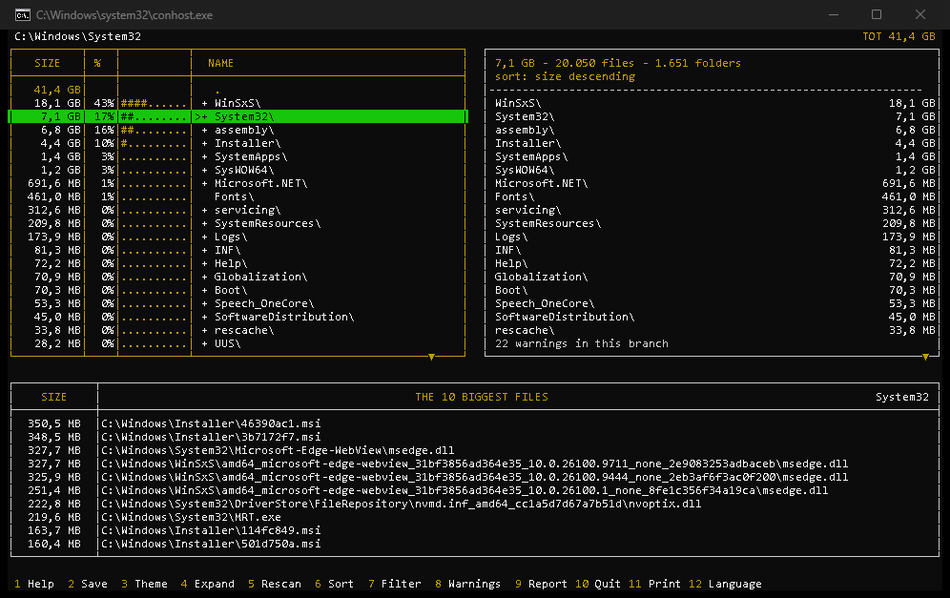

<table>
  <tr>
    <td width="75%" valign="middle">
      <h1>Manto.FreeDisk</h1>
      <h3>Dove e' finito lo spazio sul disco?</h3>
      <p><strong><em>Un motore, due frontend da riga di comando — e un esperimento aperto: lo stesso walker parallelo in Rust e C#, misurato uno contro l'altro.</em></strong></p>
      <p>
        
        
        
      </p>
      <p>
        <a href="https://github.com/heavymanto/Manto.FreeDisk/actions/workflows/ci.yml"></a>
        
        
        
        
      </p>
      <p>
        <a href="docs/FAQ.md"></a>
        <a href="#installazione"></a>
        <a href="README.md"></a>
      </p>
    </td>
    <td width="25%" valign="middle" align="center">
      <a href="#"></a>
    </td>
  </tr>
</table>

---

## Abstract

**F.F.F — Fun For Free.** Trova i big file e scopri chi drena il disco in pochi secondi, senza fare nulla.

<p align="justify">
L'idea nasce da un fa­sti­dio: il disco sempre pieno, e nessun tool che
dicesse in un colpo d'oc­chio dove in­ter­ve­ni­re. Cosi' me lo sono
scritto. Potevo farlo in C#, il mio lin­guag­gio di lavoro da ven­t'an­ni:
ho scelto Rust, af­fian­ca­to da GLM 5.3 (open weight, on-premise). Ha
fun­zio­na­to — i file enormi di­men­ti­ca­ti sono saltati fuori subito:
backup, mac­chi­ne vir­tua­li ab­ban­do­na­te, vecchie in­stal­la­zio­ni, temp di
sistema con cen­ti­na­ia di GB usati. In un attimo ho re­cu­pe­ra­to piu' del
30% di spazio!
</p>

**Manto.FreeDisk** e' uno scanner veloce — un thread per core, le
dimensioni lette mentre enumera — e due modi di guardare la risposta:

- mfd-cli, comandi di testo pronti da integrare in altri sistemi di
  automazione, classici o AI;
- mfd-tui, sempre a terminale ma con un'interfaccia vera, come i miei
  primi tool, a cui sono ancora molto affezionato!

---

## Quanto è davvero performante Rust? L'esperimento

Dicono che Rust sia piu' veloce e beva meno memoria degli altri — ma
quanto, esattamente? Per saperlo ho scritto lo stesso scanner tre
volte, in Node, Rust e C#, e l'ho cronometrato sugli stessi file, con
gli stessi totali: tre bench, il metodo in
[docs/BENCHMARKS.md](docs/BENCHMARKS.md).

**La velocita' e' una sorpresa: Rust e C# sono appaiati — Node resta ~6
volte dietro. La memoria e' il verdetto: Rust percorre l'albero con
12,5 MB, C# con ~59, Node con ~251. Un quinto. Un ventesimo.**

Per questo Rust e' il motore. C# resta una proof of concept (il suo
sviluppo e' il prossimo capitolo del [roadmap](docs/ROADMAP.md)), Node
il prototipo con cui tutto e' iniziato. Una macchina, una sessione.
Nulla e' dato per ovvio: si misura.

```text
> powershell -ExecutionPolicy Bypass -File bench\run-bench.ps1 -Target C:\Windows -Runs 5
> powershell -ExecutionPolicy Bypass -File bench\mem-bench.ps1 -Target C:\Windows -Runs 5
```

| Implementazione | CPU, mediana (ms) | RAM, picco working set |
| --- | ---: | ---: |
| c# JIT (dimensioni dall'enumerazione, no stat) | 1378 | 59,3 MB |
| c# R2R (ReadyToRun, zero JIT) | 1464 | 59,2 MB |
| **rust (find-data via std::fs, no stat)** | **1462** | **12,5 MB** |
| node (readdir+stat per file, libuv) | 8531 | 251,3 MB |

### 1 — Prestazioni: CPU e RAM

Nell'uso della CPU tra C# e Rust finisce in pareggio, Node invece ultimo, come ci si aspettava. Chi si aspettava Rust netto vincitore resta deluso.

Nell'uso della RAM Rust e' il campione, C# secondo classificato, Node ultimo, come previsto. Il motivo e' semplice — Rust non ha un garbage collector che si porta dietro heap e strutture di runtime. Rust vince sia nel tempo di avvio che nel consumo di RAM media in generale.

### 2 — Robustezza, maturita', sviluppo

Qui vince C#: piattaforma ventennale, libreria di classi immensa, tooling al vertice. Sviluppi ovunque sia Windows, Linux, Mac, con un framework che ha 25 anni di evoluzione su Windows e una buona decade (Core), anche sui Linux/Mac. Rust e' piu' giovane (1.0 nel 2015) e piu' ripido — il borrow checker e' ostico, difficile da padroneggiare all'inizio, ma una volta compreso, e' un capolavoro di tecnologia, e' incredibile come gestisca in modo ottimale la memoria. Mi aspettavo una riduzione significativa ma non certamente del 500%. Capolavoro.

### 3 — Portabilita'

.NET ha una capacita' che Rust non ha: la cross-publish da una macchina sola — da Windows, `dotnet publish -r linux-x64 --self-contained true` produce l'eseguibile per Linux, con un comando. Rust, come C++, va ricompilato su ogni sistema su cui rilasciare. Compensa notevolmente la CI di GitHub, usando i Workflow di release: la compilazione e' automatica, anche se non hai Linux e/o Mac installati. Node invece e' trasversale in senso assoluto, una volta scritto gira ovunque, basta installare l'interprete (spesso gia' presente).

### La classifica finale

| Asse | Rust | C# | Node |
| --- | :---: | :---: | :---: |
| CPU | 🥇 5 | 🥇 5 | 2 |
| RAM | 🥇 5 | 3 | 1 |
| Maturita' ed ecosistema | 3 | 🥇 5 | 4 |
| Facilita' di sviluppo | 2 | 🥇 5 | 4 |
| Portabilita' | 1 | 4 | 🥇 5 |
| **Totale** | **16/25** | **22/25** | **16/25** |
| **Il vincitore, se…** | sei maniaco delle performance | vuoi la via ponderata | lo usi ogni tanto, da una riga di comando |

Nessuno vince in senso assoluto: **Rust e' il campione delle prestazioni** (CPU pari, un quinto della RAM, un binario da 2 MB che parte in ~10 ms), **Node quello della portabilita'** (una base di codice sola che gira ovunque), e **C# la somma migliore — il compromesso giusto**. I due puristi pareggiano a 16/25: la somma incorona il compromesso.

## Download

Niente da installare: estrai ed esegui — e basta. I due binari
funzionano subito, in modalita' portabile: l'inglese e' incorporato, e
le altre sei lingue vengono trovate in `lang/` accanto ai binari.

<details>
<summary></summary>
<br/>
<p align="center">
  <a href="#download"></a>
  <br/><br/>
  <b>Noi ti doniamo il software. Tu donaci una stella.</b> ⭐<br/>
  <i>Le stelle fanno sognare — sblocchiamo nuove funzionalita':<br/>
  a 1.000 C#-cli diventera' realta' (<a href="docs/ROADMAP.md">roadmap</a>).</i>
  <br/><br/>
  <a href="https://github.com/heavymanto/Manto.FreeDisk"></a>
  <br/><br/>
  <a href="https://github.com/heavymanto/Manto.FreeDisk/releases/download/v0.9.2/mantofreedisk-0.9.2-win-x64.zip"></a>
  <a href="https://github.com/heavymanto/Manto.FreeDisk/releases/download/v0.9.2/mantofreedisk-0.9.2-linux-x64.tar.gz"></a>
  <a href="https://github.com/heavymanto/Manto.FreeDisk/releases/download/v0.9.2/mantofreedisk-0.9.2-macos-aarch64.tar.gz"></a>
</p>
</details>

---

## Due frontend, un motore

Il motore e' uno solo (mfd-core): scansione, lente, lingue, struttura JSON. **`mfd-cli`** stampa la risposta e sta bene negli script, **`mfd-tui`** te la fa navigare a frecce. Stesso motore, stessa lente, stesse sette lingue — cambia solo come guardi.

| `mfd-cli` — la risposta, da leggere | `mfd-tui` — la risposta, da navigare |
|:---:|:---:|
| <a href="#due-frontend-un-motore"></a> | <a href="#due-frontend-un-motore"></a> |

| | `mfd-cli` | `mfd-tui` |
| --- | --- | --- |
| **Cosa e'** | il quadro: griglia di ripartizione e classifica dei piu' grossi, un comando solo | un navigatore a due pannelli con la classifica in fondo, sulla stessa scansione |
| **Si avvia** | `mfd-cli` (senza parametri) — la cartella dove sei; `<cartella>` per sceglierne un'altra | `mfd-tui` (senza parametri) — lo stesso |
| **La lente** | `-f` (glob o `REG(...)`), `-o`, `-top` | la stessa lente: `Shift+S` ordina, `Shift+F` filtra |
| **Le mosse chiave** | `-report N` solo la classifica, `-grid` solo la griglia, `-json` fotografa | `Shift+X` apre l'albero, `TAB` gira albero/dettaglio/classifica, `F1` la tastiera |
| **Il resto** | `-d a` albero intero, 7 lingue, contratto ASCII | 4 temi, stampa JSON con `Shift+P`, `F2` salva, il mouse si veste da tasto |
| **Manuale** | [FAQ](docs/FAQ.md), voci 1-9 e 11-16 · `mfd-cli -h` | [FAQ](docs/FAQ.md#10-is-there-a-version-to-navigate-not-just-to-read), voce 10 · `F1` nell'app |

## In azione

### `mfd-cli` in azione

Esecuzione senza parametri:

<a href="#mfd-cli-in-azione"></a>

Le varianti si dichiarano da sole, comando per comando: `-grid -d a
-top 12` apre l'albero intero, `-lang it` parla la lingua della
sessione, `-f REG(...)` accende la lente — dichiarata nella fascia del
titolo, perché cambia il senso di tutti i numeri.

Riferimento completo: `mfd-cli -h`. Esempi reali spiegati riga per riga:
[docs/FAQ.md](docs/FAQ.md) — la FAQ e' un pilastro del progetto: ogni voce e'
una domanda vera, un comando vero e il suo output vero.

### `mfd-tui` in azione

Una scansione, poi si naviga a frecce. Il giro completo, in movimento:
l'albero scorre, la classifica dei file piu' grossi del ramo selezionato
la segue in fondo, `TAB` gira il cursore in lettura per albero, dettaglio
e classifica, `→` scorre i nomi troppo lunghi per il pannello, e `←`
risale fino alla radice — da dove il giro ricomincia:

<a href="#mfd-tui-in-azione"></a>

Ogni `Shift+X` / `F4` apre un ramo in piu' — l'albero cresce un livello alla
volta, restando al suo posto (`Shift+A` apre tutto il sottoalbero). E quando
un nome e' troppo lungo per il pannello, col cursore in lettura `→` lo
scorre: i puntini lasciano il posto al percorso intero, cinque caratteri
alla volta:

<a href="#mfd-tui-in-azione"></a>

Le finestre e la lente: `F1` documenta la tastiera in una finestra
sola, `F12` le lingue, e `Shift+F` apre il prompt del filtro — la lente
si digita, INVIO la applica, e la griglia si restringe a quello che
conta (la fascia dichiara il filtro attivo, perché cambia il senso di
tutti i numeri):

<a href="#mfd-tui-in-azione"></a>

E il resto della tastiera, a colpo di flash: `F2` salva le impostazioni
nel profilo (tema, lente, barra), `Shift+P` / F11 stampa la fotografia
JSON di quello che stai guardando, e le cifre riscrivono al volo il
taglio della classifica (`25` = i 25 file piu' grossi).

Quattro temi, scelti con `Shift+T` / F3 — Notturno blu, Debian installer,
Console (il default), CLI. In movimento:

<a href="#mfd-tui-in-azione"></a>

---

## La struttura JSON

Ogni fotografia nasce dallo stesso serializzatore, promosso nel motore
(mfd-core): ASCII puro, ordine deterministico, diffabile byte per byte.

| Fotografia | Cosa fotografa | Come |
| --- | --- | --- |
| la griglia | le righe di livello 1 che stai guardando | `mfd-cli -json <cartella>` |
| l'albero intero | ogni cartella, ogni file — quello che serve a un diff | `mfd-cli -d a -json <cartella>` |
| il report | gli N file piu' grossi, classifica e full path | `mfd-cli -big N -json <cartella>` |
| la vista | entrambi i pannelli della TUI, come li hai lasciati | `mfd-tui`, `Shift+P` |

Una stampa vera — la cartella demo da sette file, rami chiusi, selezione
su `alpha` (`mfd-stampa-demo-tui.json`):

```json
{
  "mfd": "0.2.2",
  "root": "C:\\Users\\Public\\mfd-captures\\demo-tui",
  "filter": null,
  "depth": 4294967295,
  "totals": {"bytes": 3530, "files": 7, "dirs": 5, "warnings": 0, "elapsed_ms": 3.7},
  "warnings": [],
  "tree": {
    "bytes": 3530,
    "files": 7,
    "dirs": 5,
    "children": [
      {"name": "alpha", "bytes": 3000, "files": 2, "dirs": 0, "children": null, "leaves": null},
      {"name": "gamma", "bytes": 310, "files": 2, "dirs": 1, "children": null, "leaves": null},
      {"name": "beta", "bytes": 120, "files": 2, "dirs": 1, "children": null, "leaves": null}
    ],
    "leaves": [
      {"name": "readme.txt", "bytes": 100}
    ]
  },
  "detail": {
    "selected": "C:\\Users\\Public\\mfd-captures\\demo-tui\\alpha",
    "bytes": 3000,
    "files": 2,
    "dirs": 0,
    "rows": [
      {"name": "data.dat", "kind": "file", "bytes": 2000},
      {"name": "lib.dll", "kind": "file", "bytes": 1000}
    ]
  }
}
```

I file nascono nella cartella da cui avete lanciato `mfd-tui` — `mfd-stampa-<nome>.json`,
numerati in caso di collisione: niente sovrascritture silenziose, due
fotografie valgono un diff. La ricetta prima/dopo e le stampe della TUI
sono nel FAQ (voci 9 e 12).

---

## Installazione

Due modi di usarlo, e la differenza e' solo dove finiscono i comandi.

**Uso locale (portabile):** estraete il pacchetto scaricato e lanciate
i binari dalla loro cartella. Funziona subito: l'inglese e' incorporato
e le altre sei lingue stanno in `lang/` accanto ai binari — nessuna
traccia nel sistema, nessun privilegio richiesto.

**Comandi globali:** ogni pacchetto porta il suo script di
installazione. Pubblica i binari come comandi utente e copia le lingue
nel profilo: da quel momento `mfd-cli` e `mfd-tui` girano da
qualsiasi terminale.

| Sistema | Script | I comandi finiscono in | Le lingue finiscono in |
| --- | --- | --- | --- |
| **Windows** | `install.ps1` | `%USERPROFILE%\.local\bin` | `%APPDATA%\mfd\lang` |
| **Linux** | `install.sh` | `~/.local/bin` | `~/.config/mfd/lang` |
| **macOS** | `install-macos.sh` | `~/.local/bin` | `~/.config/mfd/lang` |

Su Windows lo script verifica anche che la cartella dei comandi sia
nel `PATH` e la aggiunge se manca — riaprite il terminale dopo
l'installazione.

**Da fonte**, infine: serve [Rust](https://rustup.rs) (`winget install
Rustlang.Rustup`, poi un terminale **nuovo** — quelli gia' aperti non
vedono il PATH che rustup ha appena scritto) e un clone di questo
repository. Tutto il resto sono due comandi:

```powershell
cd rust
cargo build --release     # circa un minuto → mfd-cli.exe e mfd-tui.exe in target\release\
.\target\release\mfd-cli.exe
```

Poi fate la domanda per cui questo tool esiste — dove e' finito lo
spazio? — e leggete la risposta in un colpo solo: sopra la mappa (le
cartelle piu' pesanti, percentuali e barre), sotto la classifica dei
file piu' grossi, full path e ordine fisso di taglia decrescente.
Quello e' Windows visto da dentro: 658 file di font per 461 MB, con i
CJK (cinese, giapponese) che pesano quanto tutto il resto. Aggiungete
`-json` e la stessa fotografia arriva in JSON
(`mfd-cli -json > quadro.json`).

## Limiti noti

- **Testato su una macchina sola, in una sessione sola.** Il bench
  confronta le implementazioni fra loro; non classifica i computer.
- **Windows, Linux, macOS.** Su Windows vale l'ottimizzazione no-`stat`
  (il trucco Win32); su Linux e macOS il walker usa `stat`. L'harness
  del bench e' PowerShell (solo Windows). La CI gira tutti i test su
  tutti e tre i sistemi a ogni push.
- Le cartelle bloccate sono warning, non errori: la griglia le mostra lo
  stesso (0 B), e i totali dicono quanti report mancano.
- Il look duf richiede un terminale ANSI; rediretto, l'output e' la
  griglia ASCII piatta di sempre (`MFD_DUF=1` forza il look anche
  attraverso una pipe, per `less -R`).
- **Solo macOS arm64** nella release: i Mac Intel compilano da fonte (un
  comando `cargo`, circa un minuto).
- La TUI parla 16 colori, per scelta: la palette della console.

## Sviluppo

```powershell
cargo test                                        # i test del workspace
powershell -ExecutionPolicy Bypass -File bench\run-bench.ps1 -Target . -Runs 2
```

## Struttura del repository

```text
rust\     famiglia Rust (workspace Cargo): crates\mfd-core (il motore),
          crates\mfd-cli (la CLI), crates\mfd-tui (il TUI interattivo)
net\      famiglia .NET: la proof of concept C# — il walker, verificato dal bench (promozione condizionata: 1.000 stelle)
node\     prototipo Node della fase 0 (congelato: storia, e un implementazione del bench)
bench\    script di benchmark (run / startup / mem) e loro risultati
docs\     ARCHITECTURE - BENCHMARKS - ROADMAP - FAQ
gui\ app\ riservate alla futura GUI e alla distribuzione app
```

## Documentazione

- [docs/FAQ.md](docs/FAQ.md) — domande vere, comandi veri, output veri
- [docs/ARCHITECTURE.md](docs/ARCHITECTURE.md) — motore e pelle, il walker, i contratti
- [docs/BENCHMARKS.md](docs/BENCHMARKS.md) — metodo, script, contratto RESULT
- [docs/ROADMAP.md](docs/ROADMAP.md) — TUI, il gemello C# su domanda, GUI, app
- [docs/DESIGN-TUI.md](docs/DESIGN-TUI.md) — il design approvato del TUI: due pannelli, una lente, e dalla 0.7.1 l'albero e il cursore di lettura

## Contribuire

Vedi [CONTRIBUTING.md](CONTRIBUTING.md). In breve: il contratto di bench e'
sacro, senza parametri si parte dalla cartella corrente, l'output e' ASCII puro, e ogni
esempio nella documentazione e' vero. Lo sviluppo e' FAQ-driven: se un esempio
risulta scomodo, quella e' una richiesta di feature. Le issue sono aperte —
tre template (bug, domanda, feature) portano il contesto, e le domande vere
diventano voci del FAQ. Le aspettative: e' un progetto hobby — tutto viene
letto, ma nessun tempo di risposta e' promesso.

## Licenza

Copyright (C) 2026 Francesco Mantovanelli.

Questo programma e' software libero: potete ridistribuirlo e/o modificarlo nei
termini della **GNU Affero General Public License v3.0** pubblicata dalla Free
Software Foundation — vedete [LICENSE](LICENSE). Per prodotti che non possono
essere distribuiti in AGPL e' disponibile, su richiesta, un canale di
licenziamento commerciale.

---

<div align="center">

**Autore** — Francesco Mantovanelli · **Progetto** — Manto.FreeDisk

</div>
