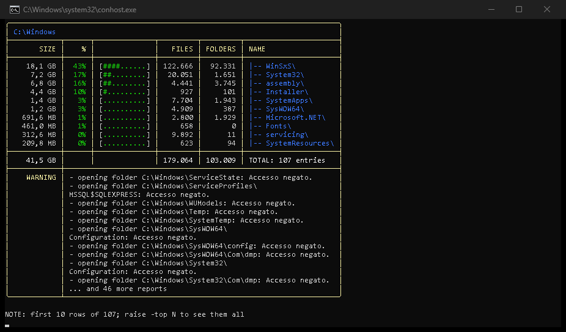
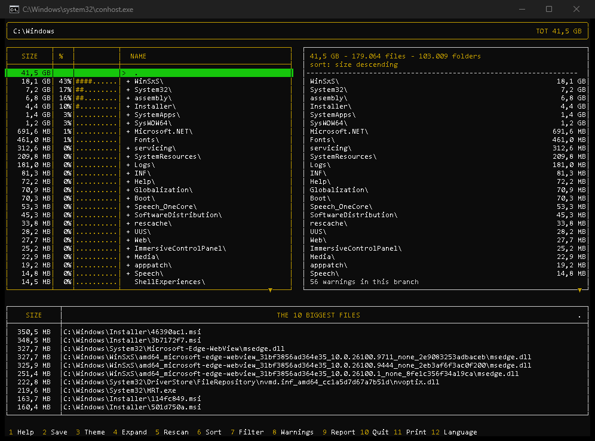
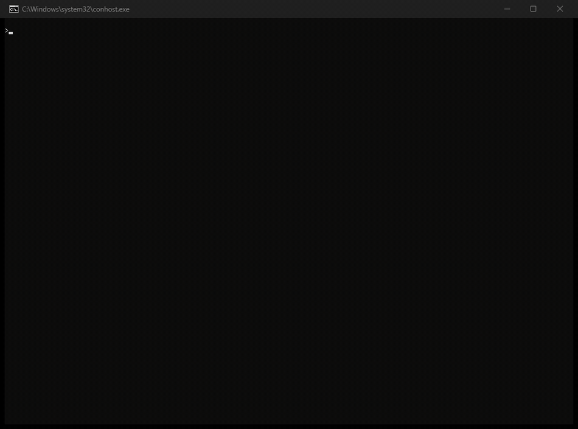
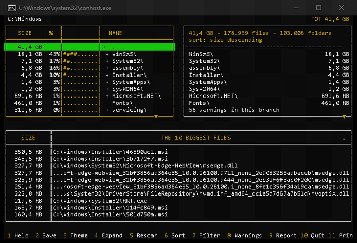
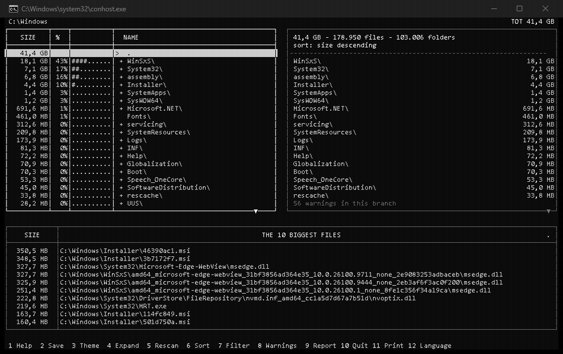
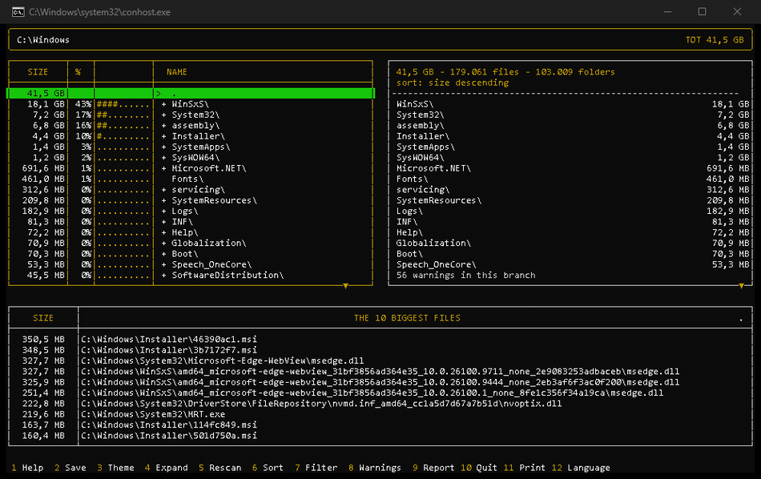
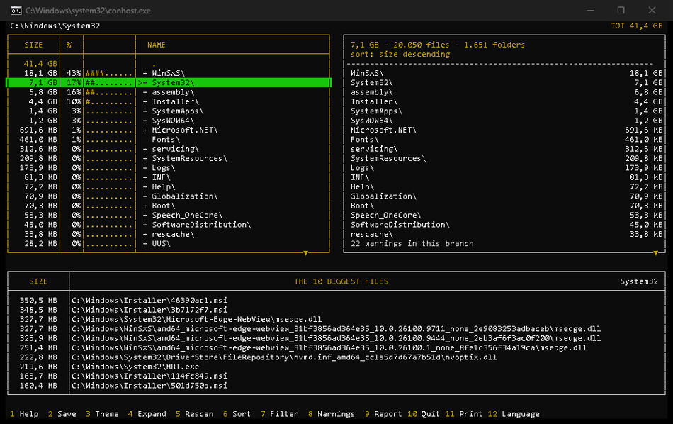

<table>
  <tr>
    <td width="75%" valign="middle">
      <h1>Manto.FreeDisk</h1>
      <h3>Where did my disk space go?</h3>
      <p><strong><em>One engine, two command-line frontends — and an open experiment: the same parallel walker in Rust and C#, measured against each other.</em></strong></p>
      <p>
        
        
        
      </p>
      <p>
        <a href="https://github.com/heavymanto/Manto.FreeDisk/actions/workflows/ci.yml"></a>
        
        
        
        
      </p>
      <p>
        <a href="docs/FAQ.md"></a>
        <a href="#installation"></a>
        <a href="README.it.md"></a>
      </p>
    </td>
    <td width="25%" valign="middle" align="center">
      <a href="#"></a>
    </td>
  </tr>
</table>

---

## Abstract

**F.F.F — Fun For Free.** Find the big files and what drains your disk, in seconds, doing nothing.

<p align="justify">
The idea comes from an an­noy­ance: the disk always full, and no tool
that said at a glance where to step in. So I wrote my own. I could
have done it in C#, my work lan­guage for twenty years: I chose Rust,
helped by GLM 5.3 (open weight, on-premise). It worked — huge
for­got­ten files sur­faced at once: backups, aban­doned virtual
ma­chines, old in­stal­la­tions, system temps with hun­dreds of GB in
use. In no time I re­cov­ered more than 30% of space!
</p>

**Manto.FreeDisk** is a fast scanner — one thread per core, sizes
read while it enumerates — and two ways to read the answer:

- `mfd-cli`, text commands ready to plug into other automation
  systems, classic or AI;
- `mfd-tui`, still on the terminal but with a real interface, like my
  first tools, which I am still very fond of!

---

## How performant is Rust, really? The experiment

They say Rust is faster and drinks less memory than the others —
but how much, exactly? To find out I wrote the same scanner three
times, in Node, Rust and C#, and timed it on the same files, with
the same totals: three benches, the method in
[docs/BENCHMARKS.md](docs/BENCHMARKS.md).

**Speed is the surprise: Rust and C# are tied — Node sits ~6x behind.
Memory is the verdict: Rust walks the tree on 12,5 MB, C# on ~59, Node
on ~251. One fifth. One twentieth.**

That is why Rust is the engine. C# stays a proof of concept (its
development is the roadmap's next chapter), Node the prototype it all
started with. One machine, one session. Nothing is taken for granted:
it gets measured.

```text
> powershell -ExecutionPolicy Bypass -File bench\run-bench.ps1 -Target C:\Windows -Runs 5
> powershell -ExecutionPolicy Bypass -File bench\mem-bench.ps1 -Target C:\Windows -Runs 5
```

| Implementation | CPU, median (ms) | RAM, peak working set |
| --- | ---: | ---: |
| c# JIT (sizes from enumeration, no stat) | 1378 | 59,3 MB |
| c# R2R (ReadyToRun, zero JIT) | 1464 | 59,2 MB |
| **rust (find-data via std::fs, no stat)** | **1462** | **12,5 MB** |
| node (readdir+stat per file, libuv) | 8531 | 251,3 MB |

### 1 — Performance: CPU and memory

On CPU, C# and Rust end in a tie, Node last as expected. If you expected Rust to be the clear winner, it isn't.

On RAM, Rust is the champion, C# second, Node last, unsurprisingly. The reason is simple — Rust has no garbage collector dragging heap and runtime structures along. Rust wins both startup time and average RAM consumption overall.

### 2 — Robustness, maturity, development

Here C# wins: a twenty-year-old platform, a huge class library, top-notch tooling. You develop everywhere — Windows, Linux, Mac — with a framework that has 25 years of evolution on Windows and a good decade (Core) on Linux/Mac too. Rust is younger (1.0 in 2015) and steeper — the borrow checker is tough, hard to master at first, but once understood, it's a masterpiece of technology, it's incredible how it manages memory optimally. I expected a significant reduction but certainly not 500%. Masterpiece.

### 3 — Portability

.NET has a capability Rust doesn't: cross-publish from a single machine — from Windows, `dotnet publish -r linux-x64 --self-contained true` produces the Linux executable, with one command. Rust, like C++, must be recompiled on every system you release for. GitHub CI compensates considerably, using release Workflows: compilation is automatic, even if you don't have Linux and/or Mac installed. Node instead is absolutely cross-platform: once written it runs anywhere, you just install the interpreter (often already present). The process is .NET's game, the artifact is Rust's.

### The final standings

| Axis | Rust | C# | Node |
| --- | :---: | :---: | :---: |
| CPU | 🥇 5 | 🥇 5 | 2 |
| RAM | 🥇 5 | 3 | 1 |
| Maturity & ecosystem | 3 | 🥇 5 | 4 |
| Ease of development | 2 | 🥇 5 | 4 |
| Portability | 1 | 4 | 🥇 5 |
| **Total** | **16/25** | **22/25** | **16/25** |
| **The winner, if…** | you are a performance maniac | you want the weighed way | you use it now and then, from one command line |

Nobody wins in absolute terms: **Rust is the performance champion** (CPU tie, one fifth of the RAM, a single 2 MB binary that starts in ~10 ms), **Node the portability one** (one codebase that runs anywhere), and **C# the best sum — the right compromise**. The two purists tie at 16/25: the sum crowns the compromise.

## Download

Nothing to install: extract and run — that's it. Both binaries work
right away, in portable mode: English is embedded, and the other six
languages are found in `lang/` next to the binaries.

[](../../releases/download/v0.9.2/mantofreedisk-0.9.2-win-x64.zip)
[](../../releases/download/v0.9.2/mantofreedisk-0.9.2-linux-x64.tar.gz)
[](../../releases/download/v0.9.2/mantofreedisk-0.9.2-macos-aarch64.tar.gz)

---

## Two frontends, one engine

One engine only (mfd-core): scan, lens, languages, JSON structure. **`mfd-cli`** prints the answer and fits scripts, **`mfd-tui`** lets you navigate it with arrows. Same engine, same lens, same seven languages — only how you look changes.

| `mfd-cli` — the answer, read | `mfd-tui` — the answer, navigated |
|:---:|:---:|
| <a href="#two-frontends-one-engine"></a> | <a href="#two-frontends-one-engine"></a> |

| | `mfd-cli` | `mfd-tui` |
| --- | --- | --- |
| **What it is** | the picture: breakdown grid and biggest-files ranking, one command | a two-panel navigator with the ranking docked below, over the same scan |
| **Start it** | `mfd-cli` with no arguments — the folder you are in; `<folder>` to choose another | `mfd-tui` with no arguments — the same |
| **The lens** | `-f` (glob or `REG(...)`), `-o`, `-top` | the same lens: `Shift+S` sort, `Shift+F` filter |
| **The key moves** | `-report N` ranking only, `-grid` grid only, `-json` photographs | `Shift+X` opens the tree, `TAB` cycles tree/detail/ranking, `F1` the keyboard |
| **The rest** | `-d a` full tree, 7 languages, the ASCII contract | 4 themes, `Shift+P` JSON print, `F2` saves, the mouse wears keys |
| **Manual** | [FAQ](docs/FAQ.md), entries 1-9 and 11-16 · `mfd-cli -h` | [FAQ](docs/FAQ.md#10-is-there-a-version-to-navigate-not-just-to-read), entry 10 · `F1` in the app |


## In action

### `mfd-cli` in action

Running with no arguments:

<a href="#mfd-cli-in-action"></a>

The variants declare themselves, command by command: `-grid -d a -top
12` opens the whole tree, `-lang it` speaks the session's language,
`-f REG(...)` lights the lens — declared in the title band, because it
changes the meaning of every number. (The outputs speak the session's
language; the OS messages inside the WARNING blocks, like "Accesso
negato", are passed through verbatim by the Italian Windows that ran
the scans.)

Full reference: `mfd-cli -h`. Real-world examples explained line by line:
[docs/FAQ.md](docs/FAQ.md) — the FAQ is a pillar of this project: every entry
is a real question, a real command, and its real output.

### `mfd-tui` in action

One scan, then the arrows. The whole round trip, in motion: the tree
scrolls, the ranking of the biggest files of the selected branch follows
at the bottom, `TAB` cycles the reading cursor through tree, detail and
ranking, `→` scrolls the names too long for the panel, and `←` climbs
back to the root — where the tour begins again:

<a href="#mfd-tui-in-action"></a>

Each `Shift+X` / `F4` opens one more branch — the tree grows a level at a
time, in place (`Shift+A` opens the whole subtree). And when a name is too
long for the panel, with the reading cursor `→` scrolls it: the `...` gives
way to the whole path, five characters at a time:

<a href="#mfd-tui-in-action"></a>

The windows and the lens: `F1` documents the whole keyboard in one
window, `F12` the languages, and `Shift+F` opens the filter prompt —
the lens gets typed, ENTER applies it, and the grid shrinks to what
matters (the title band declares the active filter, because it changes
the meaning of every number):

<a href="#mfd-tui-in-action"></a>

And the rest of the keyboard, one flash at a time: `F2` saves the
settings to the profile (theme, lens, bar), `Shift+P` / F11 prints the
JSON picture of what you are looking at, and digits rewrite the
ranking's cut on the fly (`25` = the 25 biggest files).

Four themes, chosen with `Shift+T` / F3 — night blue, Debian installer,
console (the default), CLI. In motion:

<a href="#mfd-tui-in-action"></a>

---

## The JSON structure

Every picture comes from the same serializer, promoted into the engine
(mfd-core): pure ASCII, deterministic order, byte-for-byte diffable.

| Picture | What it photographs | How |
| --- | --- | --- |
| the grid | the level-1 rows you are looking at | `mfd-cli -json <folder>` |
| the whole tree | every folder, every file — what a diff needs | `mfd-cli -d a -json <folder>` |
| the report | the N biggest files, ranking and full paths | `mfd-cli -big N -json <folder>` |
| the view | both TUI panes, as you left them | `mfd-tui`, `Shift+P` |

A real print — the seven-file demo folder, branches closed, the selection
on `alpha` (`mfd-stampa-demo-tui.json`):

```json
{
  "mfd": "0.2.2",
  "root": "C:\\Users\\Public\\mfd-captures\\demo-tui",
  "filter": null,
  "depth": 4294967295,
  "totals": {"bytes": 3530, "files": 7, "dirs": 5, "warnings": 0, "elapsed_ms": 3.7},
  "warnings": [],
  "tree": {
    "bytes": 3530,
    "files": 7,
    "dirs": 5,
    "children": [
      {"name": "alpha", "bytes": 3000, "files": 2, "dirs": 0, "children": null, "leaves": null},
      {"name": "gamma", "bytes": 310, "files": 2, "dirs": 1, "children": null, "leaves": null},
      {"name": "beta", "bytes": 120, "files": 2, "dirs": 1, "children": null, "leaves": null}
    ],
    "leaves": [
      {"name": "readme.txt", "bytes": 100}
    ]
  },
  "detail": {
    "selected": "C:\\Users\\Public\\mfd-captures\\demo-tui\\alpha",
    "bytes": 3000,
    "files": 2,
    "dirs": 0,
    "rows": [
      {"name": "data.dat", "kind": "file", "bytes": 2000},
      {"name": "lib.dll", "kind": "file", "bytes": 1000}
    ]
  }
}
```

The files land in the folder `mfd-tui` was launched from — `mfd-stampa-<name>.json`,
numbered on collision: no silent overwrites, two pictures are worth a diff.
The before/after recipe and the TUI prints are in the FAQ (entries 9 and 12).

---

## Installation

Two ways to use it, and the difference is only where the commands end up.

**Local use (portable):** extract the downloaded package and run the
binaries from their folder. It works at once: English is built in and
the other six languages live in `lang/` next to the binaries — no
trace in the system, no privilege required.

**Global commands:** every package carries its own install script.
It publishes the binaries as user commands and copies the languages
into the profile: from then on `mfd-cli` and `mfd-tui` run from any
terminal.

| System | Script | Commands land in | Languages land in |
| --- | --- | --- | --- |
| **Windows** | `install.ps1` | `%USERPROFILE%\.local\bin` | `%APPDATA%\mfd\lang` |
| **Linux** | `install.sh` | `~/.local/bin` | `~/.config/mfd/lang` |
| **macOS** | `install-macos.sh` | `~/.local/bin` | `~/.config/mfd/lang` |

On Windows the script also checks that the command folder is in the
`PATH` and adds it if missing — reopen the terminal after installing.

**From source**, finally: you need [Rust](https://rustup.rs) (`winget
install Rustlang.Rustup`, then a **new** terminal — the ones already
open don't see the PATH rustup just wrote) and a clone of this
repository. Everything else is two commands:

```powershell
cd rust
cargo build --release     # about a minute → mfd-cli.exe and mfd-tui.exe in target\release\
.\target\release\mfd-cli.exe
```

Then ask the question this tool exists for — where did the space go? —
and read the answer in one shot: the map on top (the heaviest folders,
percentages and bars), the ranking of the biggest files below, full
paths, fixed size-descending order. That is Windows seen from the
inside: 658 font files for 461 MB, with the CJK ones (Chinese,
Japanese) weighing as much as everything else. Add `-json` and the
same picture comes as JSON (`mfd-cli -json > picture.json`).

## Known limitations

- **Tested on one machine, one session.** The bench compares the
  implementations with each other; it does not rank computers.
- **Windows, Linux, macOS.** Windows carries the no-`stat` fast path (a
  Win32 contract); on Linux and macOS the walker falls back to `stat`.
  The bench harness is PowerShell (Windows only). The CI runs the whole
  test suite on all three systems at every push.
- Locked folders are warnings, not errors: the grid still shows them (0 B),
  and the totals say how many reports are missing.
- The duf look needs an ANSI terminal; redirected, the output is the
  flat ASCII grid of always (`MFD_DUF=1` forces the look even through a
  pipe, for `less -R`).
- **macOS arm64 only** in the release: Intel Macs build from source (one
  `cargo` command, about a minute).
- The TUI speaks 16 colors, by design: the console's own palette.

## Development

```powershell
cargo test                                        # the workspace's tests
powershell -ExecutionPolicy Bypass -File bench\run-bench.ps1 -Target . -Runs 2
```

## Repository layout

```text
rust\     Rust family (Cargo workspace): crates\mfd-core (the engine),
          crates\mfd-cli (the CLI), crates\mfd-tui (the interactive TUI)
net\      .NET family: the C# proof of concept — the walker, bench-verified (full twin: roadmap)
node\     phase-0 Node prototype (frozen: history, and one bench implementation)
bench\    benchmark scripts (run / startup / mem) and their results
docs\     ARCHITECTURE - BENCHMARKS - ROADMAP - FAQ
gui\ app\ reserved for the future GUI and app distribution
```

## Documentation

- [docs/FAQ.md](docs/FAQ.md) — real questions, real commands, real outputs
- [docs/ARCHITECTURE.md](docs/ARCHITECTURE.md) — engine vs. frontend, the walker, the contracts
- [docs/BENCHMARKS.md](docs/BENCHMARKS.md) — method, scripts, the RESULT contract
- [docs/ROADMAP.md](docs/ROADMAP.md) — TUI, the C# twin promotion, GUI, app
- [docs/DESIGN-TUI.md](docs/DESIGN-TUI.md) — the approved TUI design: two panels, one lens, and since 0.7.1 the tree and the reading cursor

## Contributing

See [CONTRIBUTING.md](CONTRIBUTING.md). The short version: the bench contract
is sacred, no arguments means the current directory, output is pure ASCII, and every
example in the docs is real. Development is FAQ-driven: if an example feels
awkward, that is a feature request. Issues are open — three templates (bug,
question, feature) carry the context, and the good questions become FAQ
entries. A note on expectations: this is a hobby project — everything gets
read, but no response times are promised.

## License

Copyright (C) 2026 Francesco Mantovanelli.

This program is free software: you can redistribute it and/or modify it under
the terms of the **GNU Affero General Public License v3.0** as published by the
Free Software Foundation — see [LICENSE](LICENSE). Commercial licensing is
available on request for products that cannot ship under the AGPL.

---

<div align="center">

**Author** — Francesco Mantovanelli · **Project** — Manto.FreeDisk

</div>
